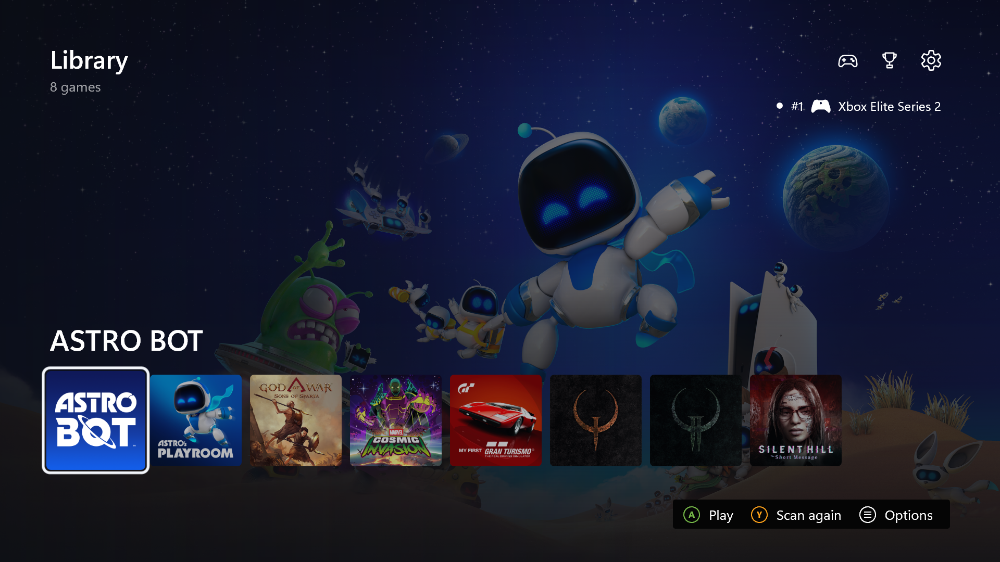
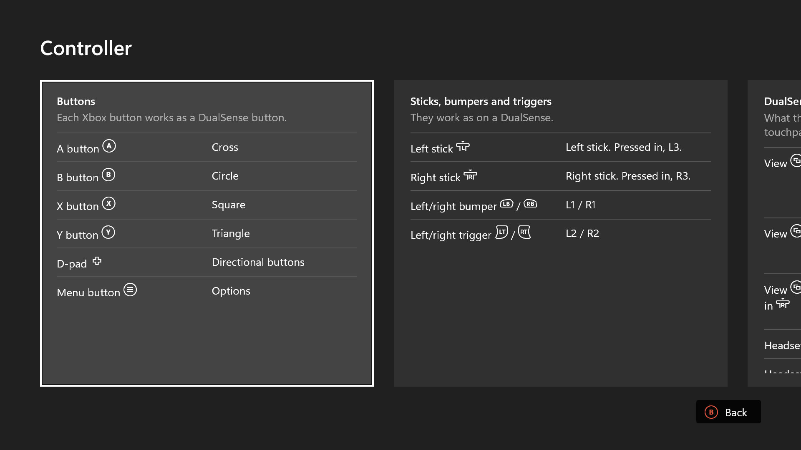
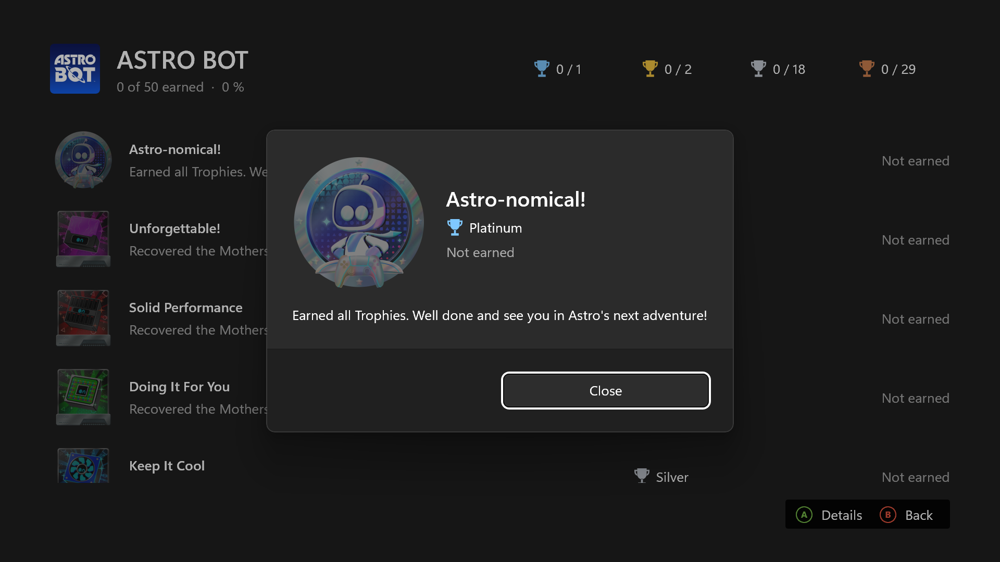
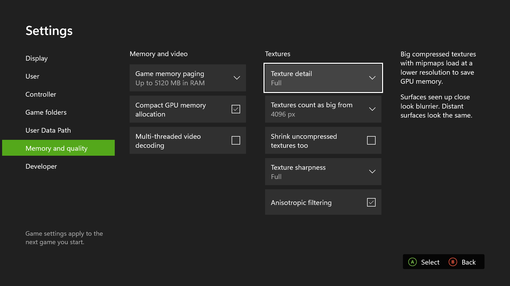
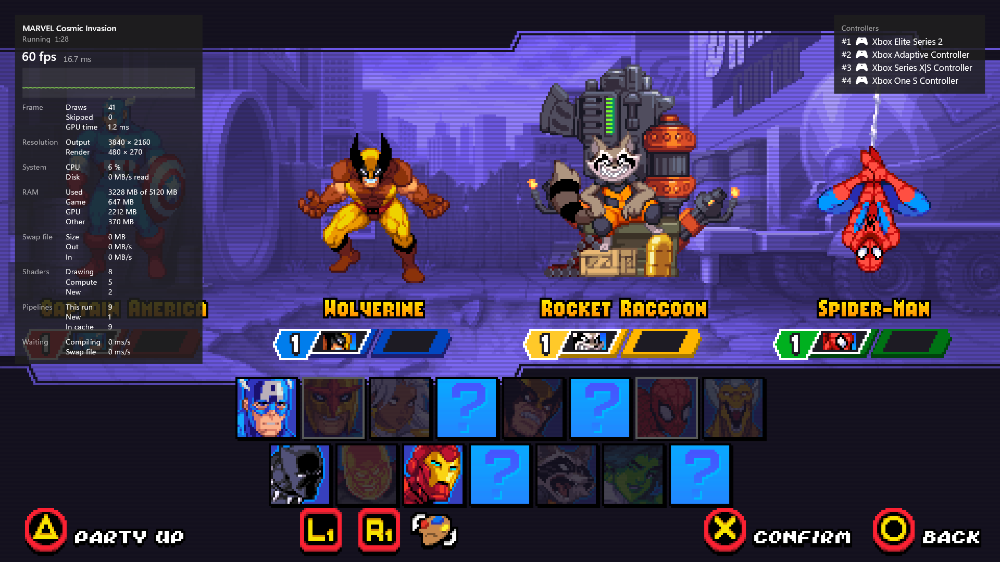
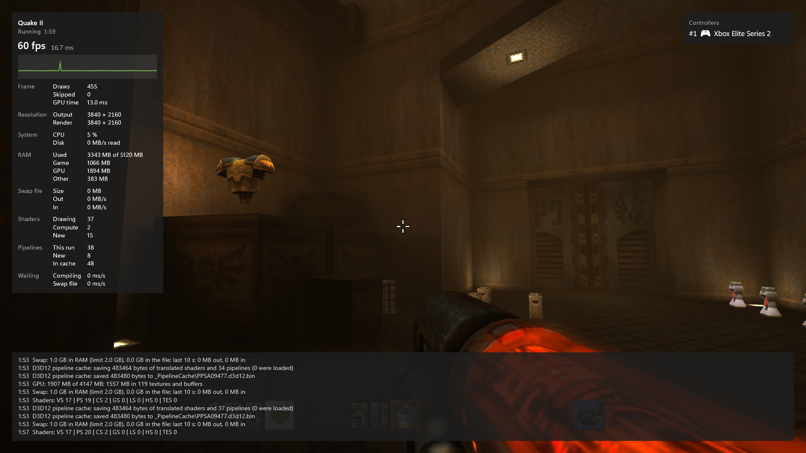
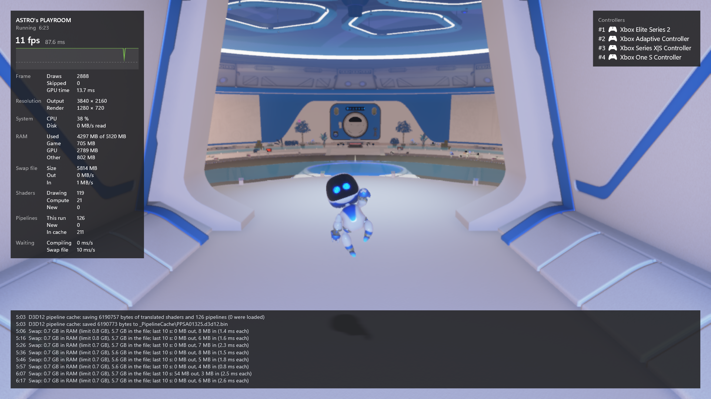

# KytyPS5 for Xbox

This fork runs [KytyPS5](https://github.com/KytyPS5/KytyPS5), a free and open-source PlayStation 5 translation layer, on the **Xbox Series X** in Developer Mode, as a UWP app that also runs on Windows.

> [!IMPORTANT]
> KytyPS5 is not affiliated with Sony Interactive Entertainment or PlayStation. The project does
> not distribute games or copyrighted system software. Use only game files that you have obtained
> legally.

What the Xbox version adds:

- **An app made for the controller.** A game library with covers, game options, settings, trophies, a controller guide and a statistics overlay, laid out like the Xbox's own screens.
- **A Direct3D 12 renderer** next to upstream's Vulkan renderer. Shaders are translated with Mesa's `spirv_to_dxil`.
- **Room for big games on the console.** Game memory is committed as it is used, a swap file keeps games within the Series X's app memory limit, and texture options trade detail for memory.
- **Up to four players.** The DualSense's touchpad, motion sensors, adaptive triggers, haptic feedback, speaker and microphone are mapped to the Xbox controller and its headset.
- **Games on a USB drive.** Game folders and `.zar` archives play from a drive, and saves, patches and trophies can live there too.

  <strong>Library</strong> 
  

<table align="center">
  <tr>
    <td align="center">
      <strong>Controller guide</strong> 
      
    </td>
    <td align="center">
      <strong>Trophies</strong> 
      
    </td>
  </tr>
  <tr>
    <td align="center">
      <strong>Settings</strong> 
      
    </td>
    <td align="center">
      <strong>Local co-op</strong> 
      
    </td>
  </tr>
  <tr>
    <td align="center">
      <strong>Light game</strong> 
      
    </td>
    <td align="center">
      <strong>Heavy game</strong> 
      
    </td>
  </tr>
</table>

The Xbox version is experimental. Not every game that runs on a PC runs on the Xbox, and draws that the Series X cannot do, such as tessellation, are skipped.

- [Releases](https://github.com/Cosmo/KytyPS5/releases) has builds for the Xbox Series X|S in Developer Mode, with the install steps.
- [XBOX_CHANGES.md](XBOX_CHANGES.md) lists every change against upstream, one commit per topic, and the known limits on the Series X.
- [src/uwp/README.md](src/uwp/README.md) explains how to build and install the app and how to set up your games.

## KytyPS5

For everything else, such as the desktop builds, running on a PC, the project's status and contributing, see [KytyPS5's README](https://github.com/KytyPS5/KytyPS5#readme).

## License

KytyPS5 is licensed under the [GNU General Public License version 2](LICENSE)
(`GPL-2.0-only`).

This project is based on the original [Kyty](https://github.com/InoriRus/Kyty), which was released
under the MIT License. Kyty's original copyright and license notice are preserved in
[`LICENSES/Kyty-MIT.txt`](LICENSES/Kyty-MIT.txt). Third-party components remain subject to the
licenses included with those components.
